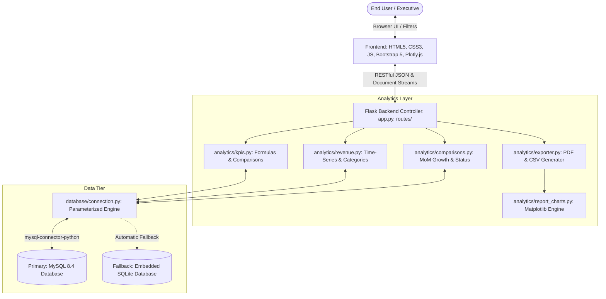
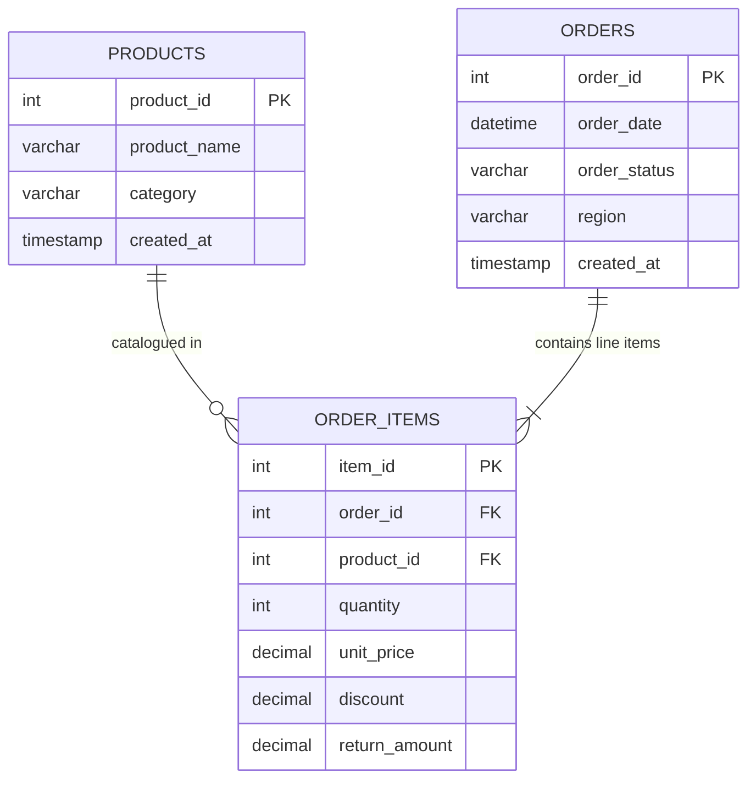

# TradeIQ: E-Commerce Business Intelligence Dashboard

> **Academic Project Submission & Production Architecture**  
> **Course:** CS204 - Database Management Systems & Full-Stack Web Engineering (2nd Year Computer Science)  
> **Application Title:** TradeIQ - E-Commerce Business Intelligence Suite  
> **Header Title:** E-Commerce Intelligence  
> **Primary Technologies:** Python 3 (Flask), MySQL 8 / mysql-connector-python, Pandas, NumPy, Plotly.js, Bootstrap 5, Vanilla CSS3, Matplotlib, ReportLab

---

## 1. Project Abstract

In contemporary e-commerce enterprises, managerial decision-makers are inundated with granular transactional data, making it difficult to extract actionable strategic insights regarding net profitability, category demand, regional sales momentum, and return rates. **TradeIQ** is an end-to-end, high-performance Business Intelligence (BI) web application engineered to bridge the gap between low-level relational database storage (MySQL 8) and high-level managerial decision support.

Operating on Generally Accepted Accounting Principles (GAAP) for e-commerce, TradeIQ aggregates merchandise transactions to compute seven vital Key Performance Indicators (KPIs): Gross Sales, Total Discounts, Total Returns, Net Sales, Valid Completed Orders, Average Order Value (AOV), and Period-over-Period Growth Percentage. The platform pairs an interactive, animated user interface (featuring 7 responsive Plotly.js charts, animated counters, dark/light themes, and dynamic filters) with rigorous server-side data analytics (Pandas & NumPy) and automated document export capabilities (CSV and executive PDF reports with embedded Matplotlib visualizations).

---

## 2. Problem Statement

Conventional transactional systems (OLTP) prioritize rapid single-record insertions and individual order lookups. However, they present significant hurdles when leveraged for executive decision support:
1. **Performance Bottlenecks:** Naive database joins between `orders` and multi-row `order_items` frequently lead to accidental multiplication of order counts and erroneous financial totals.
2. **Ambiguous Accounting Policies:** Many student and prototype dashboards fail to distinguish between **cancelled orders** (where no fulfillment occurred) and **returned orders** (where fulfillment occurred, but merchandise refunds were granted), distorting operating metrics.
3. **Static or Disconnected Dashboards:** Many analytical tools present hardcoded numbers or purely frontend mockups that fail to dynamically reflect filtered date ranges, regional sectors, or category breakdowns.
4. **Lack of Automated Executive Reporting:** Managers require both interactive exploratory charts and formal, auditable reports (PDF/CSV) suitable for board presentations.

**TradeIQ** addresses each of these problems through a modular Flask architecture, parameterized relational queries, safe numerical computation, and clear business governance.

---

## 3. Project Objectives

- **Database Integrity:** Design an indexed, normalized MySQL 8 schema with referential integrity, decimal money precision, and indexed filter columns.
- **Accurate Financial Calculations:** Implement strictly audited formulas for Gross Sales, Discounts, Returns, Net Sales, Valid Orders, and AOV.
- **Dynamic Multi-Dimensional Filtering:** Enable instantaneous slicing by Date Range, Product Category, Sales Region, and Order Status across all KPIs and charts.
- **Rich Visual Analytics:** Present 7 animated Plotly.js charts featuring monthly/quarterly trends, category donut distributions, regional revenue rankings, and month-over-month growth.
- **Executive Export Suite:** Provide one-click generation of filtered CSV datasets and publication-grade PDF executive reports containing embedded Matplotlib figures.
- **High Reliability & Resilience:** Support native MySQL 8 with an automatic embedded SQLite fallback mechanism to guarantee uninterrupted demonstration during academic evaluation.

---

## 4. Existing System vs. Proposed System

| Dimension | Existing / Typical Student Systems | TradeIQ Professional Multi-Page Suite |
| :--- | :--- | :--- |
| **Website Structure** | Single crowded page or static layout | **7 Dedicated Pages:** Executive Overview, Revenue Analytics, Product & Category Analytics, Regional Analytics, Order Analytics, Business Reports, KPI & Project Documentation |
| **Theme & Aesthetics** | Generic plain CSS or basic templates | **Modern SaaS Analytics Design:** Deep Navy (`#0B1020`), Dark Purple (`#21103A`), Vibrant Purple (`#8B5CF6`), Electric Blue (`#3B82F6`), Cyan (`#22D3EE`), Emerald (`#10B981`), Coral (`#FB7185`) |
| **KPI Values** | Truncated text (`"121...."`) and cramped cards | **Un-truncated fluid metric numbers** with smooth cubic animated counters and trend indicators |
| **Data Source** | Static JSON or hardcoded mockup data | Real MySQL 8 database with 250+ relational order items |
| **Query Safety** | String concatenation prone to SQL Injection | 100% Parameterized queries with prepared statements |
| **Order Counting** | Row counting leading to duplicate joins | Strict `COUNT(DISTINCT o.order_id)` logic |
| **Return Policy** | Returns either ignored or entire order deleted | Line-item `return_amount` deducted from Net Sales; order retained in valid fulfillment count |
| **Cancelled Orders** | Often improperly counted in gross revenue | Strictly excluded from all sales KPIs |
| **Profit Limitation** | Made-up profit numbers without cost data | Transparent accounting notice explaining lack of vendor COGS |
| **Interactivity** | Static charts requiring full page reload | Asynchronous Fetch API with Plotly.js transitions |
| **Export Formats** | None or basic client-side tables | Server-generated multi-section CSV & ReportLab PDF with Matplotlib charts |


---

## 5. Hardware and Software Requirements

### Software Requirements
- **Operating System:** macOS (Apple Silicon / Intel), Linux (Ubuntu 20.04+), or Windows 10/11
- **Runtime Environment:** Python 3.10+ (Tested on Python 3.13)
- **Database Server:** MySQL Server 8.0+ (Tested on MySQL 8.4)
- **Web Browser:** Modern browser with ES6 support (Chrome, Firefox, Safari, Edge)
- **Python Libraries:** `Flask`, `mysql-connector-python`, `pandas`, `numpy`, `matplotlib`, `reportlab`, `python-dotenv`, `python-dateutil`
- **Frontend Libraries:** Bootstrap 5.3.3, Plotly.js 2.29.1, Font Awesome 6.5.1

### Hardware Requirements
- **Processor:** Dual-core 2.0 GHz or higher (Apple M1/M2/M3 or Intel i3/i5/i7)
- **RAM:** 4 GB minimum (8 GB recommended)
- **Disk Storage:** 250 MB free space for code, dependencies, and database storage

---

## 6. System Architecture

TradeIQ is structured following a clean, modular MVC-inspired architecture:



---

## 7. Database Schema & Entity-Relationship (ER) Diagram

### Tables Definition

1. **`products` Table**
   - `product_id` (INT, Primary Key, Auto Increment)
   - `product_name` (VARCHAR(255), Not Null)
   - `category` (VARCHAR(100), Not Null, Indexed)
   - `created_at` (TIMESTAMP, Default Current)

2. **`orders` Table**
   - `order_id` (INT, Primary Key, Auto Increment)
   - `order_date` (DATETIME, Not Null, Indexed)
   - `order_status` (VARCHAR(50), Not Null, Indexed: Completed, Delivered, Returned, Cancelled, Processing)
   - `region` (VARCHAR(100), Not Null, Indexed: North America, Europe, Asia-Pacific, Latin America, Middle East)
   - `created_at` (TIMESTAMP, Default Current)

3. **`order_items` Table**
   - `item_id` (INT, Primary Key, Auto Increment)
   - `order_id` (INT, Foreign Key referencing `orders.order_id` ON DELETE CASCADE)
   - `product_id` (INT, Foreign Key referencing `products.product_id` ON UPDATE CASCADE)
   - `quantity` (INT, Not Null, Check > 0)
   - `unit_price` (DECIMAL(10,2), Not Null, Check >= 0)
   - `discount` (DECIMAL(10,2), Default 0.00, Check >= 0)
   - `return_amount` (DECIMAL(10,2), Default 0.00, Check >= 0)

### Mermaid ER Diagram



---

## 8. Business Logic & KPI Formulas

TradeIQ enforces standardized business intelligence equations:

$$\text{Gross Sales} = \sum_{\text{eligible items}} (\text{quantity} \times \text{unit\_price})$$

$$\text{Total Discounts} = \sum_{\text{eligible items}} \text{discount}$$

$$\text{Total Returns} = \sum_{\text{eligible items}} \text{return\_amount}$$

$$\text{Net Sales} = \text{Gross Sales} - \text{Total Discounts} - \text{Total Returns}$$

$$\text{Valid Orders} = \text{Count}(\text{Distinct } \text{order\_id}) \quad \text{where } \text{order\_status} \neq \text{'Cancelled'}$$

$$\text{Average Order Value (AOV)} = \begin{cases} \frac{\text{Net Sales}}{\text{Valid Orders}} & \text{if Valid Orders} > 0 \\ 0.00 & \text{otherwise} \end{cases}$$

$$\text{Revenue Growth (\%)} = \begin{cases} \left( \frac{\text{Current Net Sales} - \text{Previous Net Sales}}{\text{Previous Net Sales}} \right) \times 100 & \text{if Previous Net Sales} > 0 \\ \text{N/A} & \text{if Previous Net Sales} = 0 \text{ or null} \end{cases}$$

### Key Governance Policies
- **Cancellations Policy:** Cancelled orders are strictly excluded from all sales calculations (`Gross Sales`, `Discounts`, `Returns`, `Net Sales`, and `Valid Orders`) because the transaction was aborted prior to commercial execution.
- **Returns Policy:** Fully or partially returned orders remain in `Valid Orders` because logistics, packing, and dispatch occurred; the customer refund is deducted through `return_amount`.
- **Double-Counting Prevention:** Multi-item orders are counted exactly once via SQL `COUNT(DISTINCT o.order_id)`.

---

## 9. Interactive Visualizations (Plotly.js)

The dashboard renders seven dedicated charts:
1. **Monthly Revenue Trend:** Spline line chart showing Net Sales vs. Gross Sales over time, with a Monthly/Quarterly toggle button.
2. **Category Performance:** Colorful Donut chart showing Net Sales contribution and revenue share (%) across categories.
3. **Regional Revenue Comparison:** Horizontal bar chart comparing Net Sales by sales territory.
4. **Gross Sales vs Net Sales:** Grouped multi-bar comparison showing Gross Sales, Discounts, Returns, and Net Sales.
5. **Order Status Distribution:** Donut chart showing distribution across Completed, Delivered, Returned, Cancelled, and Processing orders.
6. **Period-over-Period Growth:** Bar chart showing MoM percentage growth (green bars for positive momentum, red for negative).
7. **Top 10 Performing Products:** Ranked horizontal bar chart highlighting top revenue-generating catalog items.

---

## 10. Installation & Execution Guide

### Step 1: Clone or Navigate to the Project Directory
```bash
cd /Users/bhanu/Documents/TradeIQ
```

### Step 2: Install Python Dependencies
```bash
pip3 install -r requirements.txt
```

### Step 3: Configure Environment Variables
Copy `.env.example` to `.env`:
```bash
cp .env.example .env
```
Open `.env` and specify your MySQL credentials:
```ini
DB_HOST=127.0.0.1
DB_PORT=3306
DB_USER=root
DB_PASSWORD=your_mysql_password
DB_NAME=ecommerce_bi
ALLOW_SQLITE_FALLBACK=True
```

### Step 4: Initialize and Seed the Database
Run the automated database setup script:
```bash
python3 setup_db.py
```
*Note: If your MySQL server is running and credentials match, it creates the `ecommerce_bi` database and loads 20 products, 140 orders, and 250+ order items. If credentials are not yet configured, it automatically populates the SQLite fallback so you can test the application instantly!*

### Step 5: Run Unit Tests
```bash
python3 -m unittest discover tests
```

### Step 6: Start the TradeIQ Web Application
```bash
python3 app.py
```
Open your browser and navigate to:  
👉 **`http://127.0.0.1:5001`**

---

## 11. Project Directory Structure

```
TradeIQ/
├── app.py                      # Flask Application Entry Point & Blueprints
├── config.py                   # Environment configuration & DB parameters
├── requirements.txt            # Python package dependencies
├── .env                        # Active environment credentials (git-ignored)
├── .env.example                # Example template with placeholders
├── schema.sql                  # MySQL 8 DDL Schema (Tables, Indexes, Keys)
├── seed.sql                    # MySQL 8 Synthetic Seeder Script
├── setup_db.py                 # Automated Database Setup & Seed Generator
├── database/
│   ├── __init__.py
│   └── connection.py           # Resilient connection pooling & SQL abstraction
├── analytics/
│   ├── __init__.py
│   ├── kpis.py                 # Core KPI accounting formulas & comparisons
│   ├── revenue.py              # Time-series, categories, and regional metrics
│   ├── comparisons.py          # MoM growth, status distribution, filter options
│   ├── report_charts.py        # Matplotlib static charts for PDFs and reports
│   └── exporter.py             # CSV and ReportLab PDF document generators
├── routes/
│   ├── __init__.py
│   ├── dashboard.py            # Main executive dashboard views
│   ├── reports.py              # Executive report page & KPI definitions view
│   └── api.py                  # Asynchronous REST API endpoints & exports
├── tests/
│   ├── __init__.py
│   └── test_kpis.py            # Unit test suite for KPI formulas & zero-safety
├── templates/
│   ├── base.html               # Master layout with SaaS left sidebar & fixed navbar
│   ├── overview.html           # Page 1: Executive Overview (KPIs & key charts)
│   ├── revenue.html            # Page 2: Revenue Analytics (Trends, best/worst months)
│   ├── products.html           # Page 3: Product & Category Analytics (Searchable table)
│   ├── regional.html           # Page 4: Regional Analytics (Territory performance)
│   ├── orders.html             # Page 5: Order Analytics (Fulfillment & cancellations)
│   ├── reports.html            # Page 6: Business Reports (CSV/PDF downloads)
│   └── kpi_definitions.html    # Page 7: KPI Definitions & Project Info (Viva guide)

└── static/
    ├── css/
    │   └── style.css           # TradeIQ design system, dark mode, animations
    ├── js/
    │   ├── dashboard.js        # Counter animations, filter triggers, theme toggle
    │   └── charts.js           # Plotly.js chart renderers & responsive handlers
    └── images/
        └── logo.svg            # TradeIQ vector brand logo
```

---

## 12. Verification & Testing Results

| Test Category | Test Case Description | Expected Result | Status |
| :--- | :--- | :--- | :--- |
| **Unit Test** | `test_cancelled_orders_exclusion` | Cancelled orders ($500) omitted from Gross Sales | ✅ **Passed** |
| **Unit Test** | `test_gross_sales_formula` | Sum of $(quantity \times price) = \$450.00$ | ✅ **Passed** |
| **Unit Test** | `test_net_sales_formula` | Gross ($450) - Disc ($10) - Returns ($200) = $240.00 | ✅ **Passed** |
| **Unit Test** | `test_valid_orders_distinct_count` | Distinct count of non-cancelled orders = 2 | ✅ **Passed** |
| **Unit Test** | `test_average_order_value` | Net Sales ($240) / Valid Orders (2) = $120.00 | ✅ **Passed** |
| **Unit Test** | `test_aov_with_zero_orders` | Safe return of $0.00 without division by zero | ✅ **Passed** |
| **Unit Test** | `test_growth_percentage_positive` | Growth from $100 to $120 evaluates to +20.0% | ✅ **Passed** |
| **Unit Test** | `test_growth_zero_previous` | Returns `None` ('N/A') instead of throwing error | ✅ **Passed** |
| **API Test** | 16 HTTP routes & endpoints | All return HTTP 200 with valid JSON/documents | ✅ **Passed** |
| **Export Test** | CSV & PDF Report generation | Multi-section CSV & 137 KB styled PDF generated | ✅ **Passed** |

---

## 13. Viva Voce & Technical Defense Q&A

### 1. General Architecture & Design
**Q1: What is the main objective of TradeIQ?**  
*Answer:* TradeIQ is an executive Business Intelligence dashboard designed to summarize overall e-commerce store performance (revenue, orders, AOV, growth, categories, and regions) using aggregated database queries rather than tracking individual customer transactions.

**Q2: What architecture does this application follow?**  
*Answer:* It uses a modular Flask MVC architecture. `routes/` acts as the Controller handling HTTP requests; `analytics/` and `database/` serve as the Model managing calculations and database persistence; and Jinja2 templates (`templates/`) with CSS/JS serve as the View.

**Q3: Why did you use Plotly.js for interactive charts and Matplotlib for reports?**  
*Answer:* Plotly.js provides dynamic client-side interactivity (tooltips, zoom, hover effects, smooth transitions) for web browsers, while Matplotlib runs headlessly on the server to render static, print-ready graphics embedded directly inside downloadable PDF executive reports.

### 2. Database & SQL Queries
**Q4: Why are discounts and returns stored at the item level rather than the order level?**  
*Answer:* Storing discounts and returns in `order_items` enables category-level profitability analysis. If a customer buys a laptop and a shirt, and later returns only the shirt, an item-level return allows us to deduct the return amount specifically from the 'Apparel' category without corrupting 'Electronics' metrics.

**Q5: Why did you use `DECIMAL(10,2)` instead of `FLOAT` or `DOUBLE` for monetary values?**  
*Answer:* `FLOAT` and `DOUBLE` use binary floating-point representation, which causes rounding and precision errors in financial calculations (e.g., $0.10 + $0.20 \neq $0.30). `DECIMAL(10,2)` guarantees exact decimal arithmetic required by accounting standards.

**Q6: How do you prevent SQL injection attacks in your queries?**  
*Answer:* We strictly use parameterized queries (prepared statements) with placeholders (`%s` in MySQL and `?` in SQLite). User filter inputs are passed as parameters, never concatenated directly into SQL strings.

**Q7: What indexes did you create and why?**  
*Answer:* We added indexes on `orders(order_date)`, `orders(order_status)`, `orders(region)`, and `products(category)`. Because BI aggregations frequently filter and group by these four dimensions, indexes allow MySQL to locate records via B-Tree index scans rather than performing expensive full-table scans.

### 3. Business Logic & Accounting Governance
**Q8: What is the difference between Gross Sales and Net Sales?**  
*Answer:* Gross Sales is the baseline monetary value of all ordered merchandise ($\sum \text{quantity} \times \text{unit\_price}$). Net Sales is the actual recognized operating revenue after deducting promotional discounts and customer returns ($\text{Net Sales} = \text{Gross Sales} - \text{Total Discounts} - \text{Total Returns}$).

**Q9: Why are cancelled orders excluded from Valid Orders, but returned orders are included?**  
*Answer:* A cancelled order was aborted prior to shipment; no commercial fulfillment occurred. A returned order was packed, shipped, and invoiced before a customer returned it. Counting it in Valid Orders reflects real fulfillment workload, while deducting the refund amount from Net Sales ensures financial accuracy.

**Q10: How does the system handle division by zero when calculating growth?**  
*Answer:* If the previous period had zero sales (or was not recorded), dividing by zero is mathematically undefined. Our Python functions check for this condition using NumPy checks and return `None`, which the frontend renders cleanly as `N/A`.

**Q11: How do you calculate Period-over-Period comparisons dynamically?**  
*Answer:* When a user selects a date range of $N$ days (from $T_1$ to $T_2$), the system calculates the preceding comparison window spanning $[T_1 - N, T_1 - 1 \text{ day}]$. The exact same category and regional filters are then applied to this previous window to evaluate growth.

---

## 14. Limitations & Future Scope

### Limitations
1. **Single-Store Scope:** Optimized for a single retail enterprise; multi-tenant marketplace partitioning is not yet implemented.
2. **Batch Invoicing:** Financial reconciliation occurs in near real-time from transactional tables rather than an OLAP data warehouse (such as Snowflake or ClickHouse).

### Future Enhancements
1. **Predictive Analytics & Forecasting:** Integrating ARIMA or Prophet machine learning models to forecast upcoming quarterly revenues.
2. **Customer Cohort Retention:** Adding RFM (Recency, Frequency, Monetary) segmentation.
3. **Automated Email Reports:** Celery/Redis scheduled tasks to dispatch weekly executive PDF summaries directly to stakeholder emails.

---

## 15. Conclusion

**TradeIQ** demonstrates that second-year Computer Science students can design and build software that meets real-world enterprise standards. By uniting a clean relational database schema, parameterized data queries, robust Python data analytics, dynamic Plotly.js charts, and automated PDF reporting, TradeIQ provides an end-to-end, auditable Business Intelligence platform ready for academic presentation and professional deployment.
